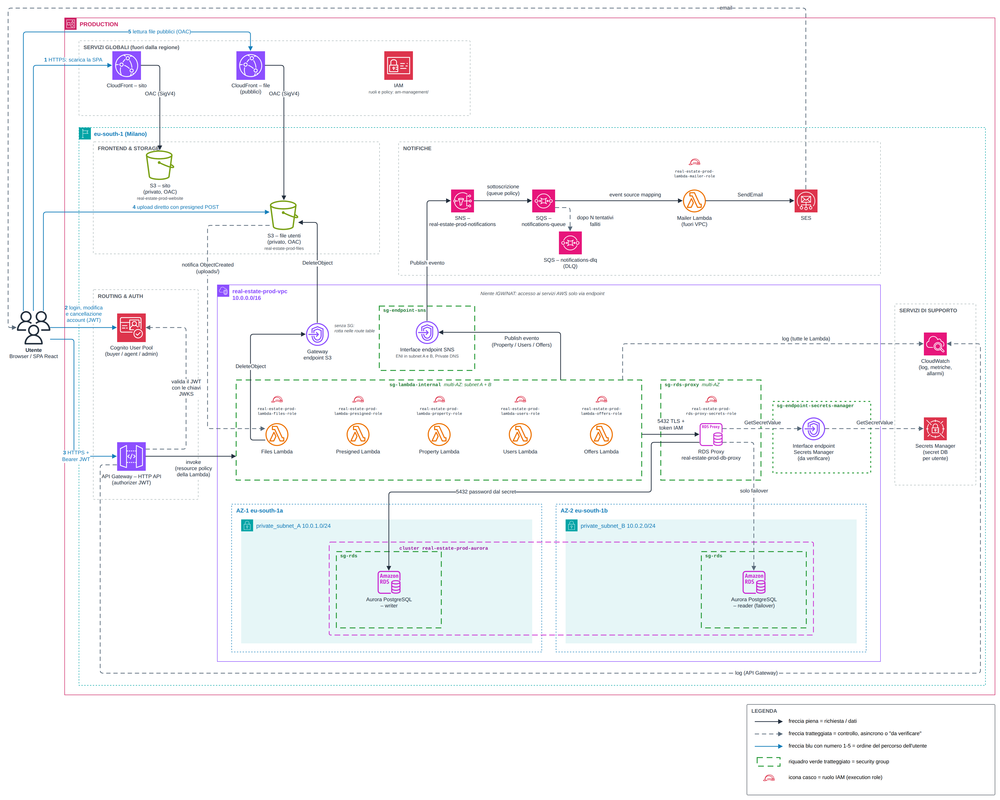

# Real Estate Infrastructure — documentazione definitiva

Piattaforma immobiliare **serverless** su AWS, nella regione `eu-south-1` (Milano): i visitatori consultano gli
annunci, gli agenti pubblicano immobili con foto e video, gli acquirenti fanno offerte e ricevono notifiche via email.
Progetto di gruppo per l'esame di Servizi Cloud (ITS ICT Torino).

Questa cartella è la versione valida e completa della documentazione: un file per ogni servizio, ciascuno con i suoi
ruoli, policy, trust relationship, resource policy e configurazioni. I JSON stanno nelle cartelle `iam/` e `config/`
e sono mostrati anche dentro i file dei servizi. I documenti precedenti sono in
[`../archivio/`](../archivio/README.md) e servono solo come storia.

I JSON sono **template**: account, ID e ARN reali restano segnaposto `<...>` e si sostituiscono al provisioning.
La documentazione descrive la configurazione prevista: non attesta risorse già create in un account AWS.

## Diagramma

Sorgente modificabile con draw.io: [`diagrammi/real-estate-v2.drawio`](diagrammi/real-estate-v2.drawio).
Legenda del diagramma: freccia piena = richiesta o dati; freccia tratteggiata = controllo, asincrono o "da verificare";
frecce blu numerate 1-5 = ordine del percorso dell'utente (1 scarica la SPA, 2 login e gestione account, 3 chiamate API
con JWT, 4 upload con presigned POST, 5 lettura dei file pubblici); riquadro verde tratteggiato = security group;
icona del casco = ruolo IAM (execution role).

Nel diagramma alcuni nomi sono abbreviati: i bucket senza `-<SUFFIX>`, coda e DLQ senza il prefisso `real-estate-prod-`
(i nomi completi sono `real-estate-prod-notifications-queue` e `real-estate-prod-notifications-dlq`), le Lambda con il
nome breve (Property Lambda = `real-estate-prod-property`). Il riquadro IAM rimanda ancora ad `am-management/`, che ora è
in archivio: ruoli e policy sono in [iam.md](iam.md). Manca la freccia Property Lambda → gateway S3, usata quando si
cancella un immobile per togliere i suoi file ([lambda-property.md](lambda-property.md#cancellazione-di-un-immobile)).

## Mappa dei file

| File | Di cosa parla |
| --- | --- |
| [00-architettura.md](00-architettura.md) | Visione d'insieme: componenti, flussi end-to-end numerati, scelte di fondo, ordine di creazione |
| [iam.md](iam.md) | IAM centrale: concetti, tutti i ruoli, tutte le resource policy, cosa non ha ruoli, deploy e `PassRole` |
| [decisioni-e-punti-aperti.md](decisioni-e-punti-aperti.md) | Le decisioni prese con il motivo, le alternative scartate e le domande ancora aperte |
| [cloudfront.md](cloudfront.md) | Le due distribuzioni (sito e file), OAC, regole SPA, HTTPS |
| [s3.md](s3.md) | I due bucket privati, bucket policy, CORS, presigned POST, notifica `ObjectCreated` |
| [cognito.md](cognito.md) | User pool, gruppi, token, gestione dell'account dal frontend, perché l'ID token |
| [api-gateway.md](api-gateway.md) | HTTP API, authorizer JWT, route, CORS, permessi di invocazione delle Lambda, throttling |
| [lambda.md](lambda.md) | Regole comuni alle Lambda: execution role, VPC, connessione al DB, invocazione |
| [lambda-property.md](lambda-property.md) | Property Lambda: annunci immobiliari |
| [lambda-users.md](lambda-users.md) | Users Lambda: profilo utente nel database |
| [lambda-offers.md](lambda-offers.md) | Offers Lambda: offerte sugli immobili |
| [lambda-presigned.md](lambda-presigned.md) | Presigned Lambda: firma degli upload |
| [lambda-files.md](lambda-files.md) | Files Lambda: registrazione e cancellazione dei file |
| [lambda-mailer.md](lambda-mailer.md) | Mailer Lambda: invio delle email, fuori dalla VPC |
| [vpc.md](vpc.md) | VPC, subnet, route table, security group (tabella SG → SG) |
| [vpc-endpoints.md](vpc-endpoints.md) | Endpoint SNS, Secrets Manager e S3, Private DNS, endpoint policy |
| [aurora.md](aurora.md) | Cluster Aurora PostgreSQL, writer e reader, utenti PostgreSQL |
| [rds-proxy.md](rds-proxy.md) | RDS Proxy: pooling, autenticazione IAM delle Lambda, ruolo del proxy |
| [secrets-manager.md](secrets-manager.md) | Secret degli utenti PostgreSQL, letti solo dal proxy |
| [kms.md](kms.md) | Chiavi di cifratura usate dai servizi, perché SSE-SQS |
| [sns.md](sns.md) | Topic delle notifiche |
| [sqs.md](sqs.md) | Coda delle notifiche e dead-letter queue |
| [ses.md](ses.md) | Invio delle email, sandbox |
| [cloudwatch.md](cloudwatch.md) | Log, metriche e allarmi |

JSON (ognuno è mostrato e spiegato nel file del servizio che lo usa; l'elenco completo è in [iam.md](iam.md#file-json)):

- `iam/trust-relationships/`: trust dei ruoli personalizzati (Lambda, RDS Proxy).
- `iam/policies/`: identity policy dei ruoli e la policy di deploy.
- `iam/resource-policies/`: policy attaccate alle risorse (Lambda, bucket, coda, endpoint).
- `config/`: configurazioni non IAM (CORS, coda, DLQ, sottoscrizione, notifica S3, presigned POST).

## Ordine di studio consigliato

1. [00-architettura.md](00-architettura.md): prima il quadro, con i flussi.
2. La rete: [vpc.md](vpc.md), poi [vpc-endpoints.md](vpc-endpoints.md). Spiega perché alcuni servizi hanno security
   group e altri no.
3. Il percorso di una richiesta: [cloudfront.md](cloudfront.md), [s3.md](s3.md), [cognito.md](cognito.md),
   [api-gateway.md](api-gateway.md), [lambda.md](lambda.md) e le sei Lambda.
4. I dati: [rds-proxy.md](rds-proxy.md), [aurora.md](aurora.md), [secrets-manager.md](secrets-manager.md), [kms.md](kms.md).
5. Le notifiche: [sns.md](sns.md), [sqs.md](sqs.md), [ses.md](ses.md); poi [cloudwatch.md](cloudwatch.md).
6. [iam.md](iam.md) per ultimo e con calma: è la parte su cui il professore insiste. Ripassalo rifacendo ogni freccia
   del diagramma con la domanda "chi può fare cosa su quale risorsa, e perché?".
7. [decisioni-e-punti-aperti.md](decisioni-e-punti-aperti.md) prima dell'orale.

## Glossario minimo

| Termine | Significato |
| --- | --- |
| Regione / AZ | Area geografica (`eu-south-1` = Milano) / data center isolato dentro la regione. Due AZ = si sopravvive alla caduta di una |
| VPC, subnet | Rete privata isolata (`10.0.0.0/16`) / porzione della VPC legata a una sola AZ |
| ENI | Scheda di rete virtuale dentro una subnet; i security group si attaccano alle ENI |
| Security group (SG) | Firewall *stateful* di una ENI, solo regole *allow* |
| Endpoint VPC | Accesso privato a un servizio AWS dalla VPC: *interface* (ENI, a pagamento) o *gateway* (rotta, gratuito, solo S3 e DynamoDB) |
| Serverless | Nessun server da gestire: si paga per uso e il servizio scala da solo |
| JWT | Token firmato `header.payload.firma`, verificabile con la chiave pubblica di chi lo emette (JWKS) |
| ARN | Nome univoco di una risorsa: `arn:partition:servizio:regione:account:risorsa` |
| Principal | Chi agisce (un utente, un ruolo, un servizio AWS come `lambda.amazonaws.com`) |
| Ruolo IAM | Identità senza credenziali proprie: chi lo assume riceve credenziali temporanee da STS |
| Trust policy | Dice **chi** può assumere un ruolo |
| Identity policy | Dice **cosa** può fare l'identità a cui è attaccata |
| Resource policy | Attaccata a una risorsa, dice **chi** può usarla (bucket policy, queue policy, permesso di una Lambda) |
| OAC | Origin Access Control: CloudFront firma le richieste verso S3, che le accetta per bucket policy |
| Presigned POST | Modulo di upload firmato che permette al browser di caricare un file su S3 con i permessi di chi lo firma |
| DLQ | Dead-letter queue: coda dove finiscono i messaggi che falliscono troppe volte |
| Least privilege | Ogni componente ha solo i permessi che gli servono |
| Responsabilità condivisa | AWS protegge l'infrastruttura (data center, hypervisor); noi configurazione, IAM, dati e codice |
